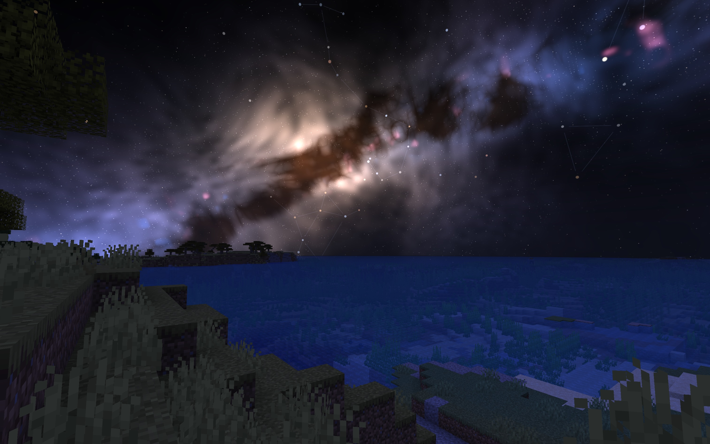

# Democritus' Stars

> "No power and no treasure can outweigh the extension of our knowledge." 
> -- Democritus

Democritus' Stars is a performant resource pack adding the night sky's brightest 780 stars, constellations, and milky way, to vanilla Minecraft.



Around 2,400 years ago, Democritus deduced the Milky Way band was made of the combined light of countless distant stars too far for our eyes to see individually. Thanks to Democritus’ theories, Galileo’s telescope, Schultze’s study of the eye and Baade’s patient sorting of the stars, we now know the band is full of colour, gold toward the centre and blue further out, and that we see it as grey only because the rods in our eyes for dim light see in greyscale. We know it is made of unfathomably many stars; we know our galaxy is one of many.

Democritus' Stars applies these learnings to make a colorized milky way night sky in Minecraft, including constellations made from the 780 brightest visible stars at night.

## Requirements

- **Minecraft Java Edition 26.3.** Other versions are not supported yet - you can try a build for your version and it will let you know of any issues.
- **Python 3.11 or newer**.
- **[uv](https://docs.astral.sh/uv/)**
- **glslangValidator**, the reference GLSL compiler. Every shader is compiled before the pack is written. 
  - macOS: `brew install glslang`
  - Ubuntu or Debian: `sudo apt install glslang-tools`
  - Windows: download it from the [glslang releases](https://github.com/KhronosGroup/glslang/releases) and
    put it on your `PATH`.

## Build the pack

Launch Minecraft with the official launcher, so the game jar file is on your disk. Then:

```sh
git clone https://github.com/rhochgraf21/Democritus-Stars.git
cd Democritus-Stars
uv run democritus
```

The installer reads the game from the launcher's folder and writes the pack into its resource pack folder as `Democritus' Stars`. In the game, open Options, then Resource Packs, and turn it on.

The installer looks for the launcher's folder at these default locations:

| System  | Folder                                    |
|---------|-------------------------------------------|
| macOS   | `~/Library/Application Support/minecraft` |
| Windows | `%APPDATA%\.minecraft`                    |
| Linux   | `~/.minecraft`                            |

If your launcher's folder is elsewhere, you can pass it manually:

```sh
uv run democritus --jar /path/to/versions/26.3/26.3.jar --pack "/path/to/resourcepacks/Democritus' Stars"
```

To leave an effect out, add `--skip` with its name, for example `--skip lighting`. `uv run democritus --help` lists the available effects.

## Tests

```sh
uv run pytest
```

## Design

`design/` records the code's design. 
It is kept with [zigdag](https://github.com/rhochgraf21/zigdag), an intent checker. 
You do not need zigdag to build the pack or run the tests.

## License

MIT. See [LICENSE](LICENSE). Minecraft is a trademark of Mojang; this project is not affiliated with Mojang or Microsoft. This repo contains no game files.
